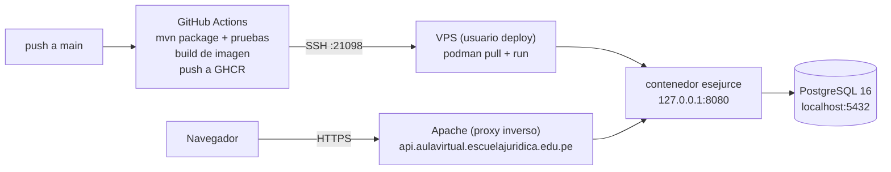

# ESEJUR — Backend

API REST de "Escuela Jurídica" (ESEJUR), plataforma de cursos en línea con matrícula, contenido, exámenes y certificación. Proyecto académico del Curso Integrador II — Software (UTP).

## Stack técnico

| Componente | Versión / detalle |
|---|---|
| Java | 21 |
| Spring Boot | 4.1.1 |
| Build | Maven (con wrapper `mvnw` / `mvnw.cmd`) |
| Persistencia | Spring Data JPA / Hibernate |
| Base de datos | PostgreSQL 15+ (H2 en memoria solo para tests) |
| Seguridad | Spring Security + OAuth2 Resource Server (JWT propio, HS256) |
| Validación | Jakarta Bean Validation |
| Correo | Spring Mail (SMTP) |
| Export | Apache POI (Excel), Apache PDFBox (PDF) |
| Documentación API | springdoc-openapi (Swagger UI) |
| Testing | JUnit 5, Mockito, Spring Security Test |

No se usa Flyway ni Liquibase: el esquema se gestiona con un script SQL manual, y no hay librería de JWT de terceros — se usa el soporte nativo de Spring Security OAuth2 Resource Server (`NimbusJwtEncoder`/`NimbusJwtDecoder`).

## Estructura de paquetes

```
src/main/java/pe/edu/utp/escuela/app/
├── controller/   16 controladores REST, uno por área funcional
├── service/      25 servicios con la lógica de negocio y las reglas de autorización
├── repository/   29 interfaces Spring Data JPA
├── entity/       35 entidades JPA (dominio completo)
├── dto/          ~115 records de petición/respuesta, separados de las entidades
├── config/       SecurityConfig, CorsConfig, WebConfig, PasswordConfig, ClockConfig
├── security/     JwtService, SessionCookieService, CurrentUserService, hash/token
├── export/       ReporteMatriculaExportador (CSV, Excel, PDF)
├── mail/         MailService, plantillas HTML
├── exception/    Jerarquía de BusinessException + GlobalExceptionHandler
└── util/         TextNormalizer y utilidades varias
```

## Modelo de dominio

**Identidad y acceso** — `Persona` (datos personales, compartida entre `Usuario` y `Firmante`), `Usuario` (cuenta de acceso), `Rol`/`UsuarioRol` (catálogo de roles con rol principal), `CodigoVerificacionCorreo`, `TokenRecuperacionAcceso`.

**Catálogos** — `TipoCurso`, `CategoriaTematica`, `EstadoCurso`, `TipoMaterial`, `EntidadCertificadora`, `Firmante`, `ConfiguracionInstitucional`.

**Cursos y contenido** — `Curso` (entidad central: precios, modalidad, fechas, cupo, estado), `CursoDocente`/`CursoFirmante` (asignaciones), `Modulo`, `Leccion` (video/documento/sesión en vivo), `Recurso` (archivo o enlace), `MaterialLeccion`, `ReglaCurso` (reglas académicas y de certificación), `ReglaArchivo`, `HistorialEstadoCurso`.

**Exámenes** — `Examen`, `Pregunta`, `OpcionPregunta`.

**Matrícula, pagos y progreso** — `Matricula`, `HistorialEstadoMatricula`, `Pago` (registro manual; integración con pasarela de pago planificada para una historia futura), `ProgresoLeccion`, `LogroCertificacion`, `Certificado`.

**Notificaciones** — `Notificacion` (registro de cada correo enviado y su resultado).

Casi todas extienden `RegistroAuditable` (`@MappedSuperclass`), que añade `creadoEn`/`modificadoEn` automáticos.

## Seguridad y autenticación

- JWT propio firmado con **HMAC-SHA256**, nunca expuesto en el cuerpo de la respuesta: viaja solo en una cookie **HttpOnly** (`ESEJUR_SESION`), con `secure`/`sameSite` configurables por entorno.
- Duración de sesión: 60 minutos (`security.jwt.expiration-minutes`), igual para el JWT y para el `maxAge` de la cookie.
- Un `BearerTokenResolver` personalizado extrae el token de la cookie en vez del header `Authorization`, e ignora rutas públicas (login, registro, verificación, recuperación, health, `/uploads/**`, swagger).
- Existe una **segunda clave JWT independiente** para las referencias de verificación de correo, deliberadamente distinta de la de sesión, para que un token de registro nunca pueda decodificarse como una cookie de sesión válida.
- **Spring Security solo distingue público vs. autenticado** a nivel de ruta (`permitAll()` / `anyRequest().authenticated()`). La autorización fina por rol (`ALUMNO` / `ADMINISTRADOR`) se implementa **dentro de cada servicio**, vía `CurrentUserService.get().hasRole("ADMINISTRADOR")`, lanzando `ForbiddenException` si no corresponde — no se usan matchers de Spring Security por rol.
- Login con correo: el mismo error se usa para correo inexistente o contraseña incorrecta, para no revelar si una cuenta existe. Verifica cuenta activa y correo verificado antes de emitir sesión.
- Login/registro con Google: no hay integración OAuth2 completa con un proveedor externo todavía; existe el flujo para completar el registro a partir de un "contexto Google" ya validado externamente (correo/`googleSubject` nunca se toman del cuerpo enviado por el navegador).
- Recuperación de contraseña: la solicitud siempre responde con un mensaje neutral exista o no la cuenta; los tokens se guardan hasheados, nunca en texto plano.

## Patrón de capas

Controller (fino, valida y delega) → Service (lógica de negocio, autorización, `@Transactional`) → Repository (Spring Data JPA). Las entidades JPA nunca se exponen directamente; los DTOs (`dto/`) son la única interfaz pública.

Manejo de errores centralizado en `GlobalExceptionHandler` (`@RestControllerAdvice`): cada subclase de `BusinessException` (`ForbiddenException`, `ResourceNotFoundException`, `InvalidCredentialsException`, `DuplicateResourceException`, etc.) expone su propio `HttpStatus` y código; errores de validación, de body ilegible y de integridad de datos se traducen a respuestas JSON consistentes (`ApiErrorResponse`), sin filtrar detalles internos al cliente.

## Funcionalidades principales

- **Autenticación y cuenta** — login, registro (con aceptación legal y desafío anti-robot propio), completar registro con Google, verificación de correo por código, recuperación de contraseña.
- **Perfil** — consultar/actualizar datos personales, cambiar contraseña con política configurable.
- **Catálogo público** — listar cursos publicados con filtros, ficha por URL amigable, vista previa de lección gratuita, sin necesidad de sesión.
- **Gestión de cursos** (admin) — alta/edición, docentes y firmantes, reglas académicas, validar y publicar, adelantar/retrasar inicio, cerrar, destacar, duplicar, eliminar.
- **Contenido del curso** (admin) — CRUD de módulos y lecciones con reordenación, sesiones en vivo, subida de materiales (archivo o enlace), activar/desactivar.
- **Exámenes y calificaciones** (admin) — CRUD de exámenes, preguntas y alternativas, reordenación.
- **Matrícula, pagos y reportes** — matrícula gratuita y administrativa, listado/detalle, advertencias académicas, cancelación, reportes exportables en CSV/Excel/PDF.
- **Administración de usuarios** (admin) — búsqueda, alta, edición, roles, activar/desactivar, resetear contraseña.
- **Información base** (admin) — catálogos maestros: tipos de curso, categorías, docentes, entidades certificadoras, firmantes, tipos de material, reglas de archivo, configuración institucional.

**Aula virtual / sesiones en vivo / materiales protegidos**: documentado como mapa técnico en `docs/epica-4/`, en construcción. Hoy `/uploads/**` es público como cualquier recurso estático — proteger el acceso real a materiales de cursos de pago es responsabilidad de esas historias, aún no implementadas.

## Base de datos

PostgreSQL 15+. `spring.jpa.hibernate.ddl-auto=validate` — Hibernate valida el esquema contra las entidades pero no lo crea ni migra; el esquema real vive en `sql/script/esejur-base-de-datos-completa.sql` (47 tablas), un script único y **destructivo** (elimina y recrea todo) que además carga datos demostrativos. No hay triggers, funciones ni vistas: toda la lógica vive en los servicios Java. Los tests usan H2 en memoria con `ddl-auto=create-drop`.

## Testing

25 archivos de test (JUnit 5 + Mockito), concentrados en `service/` (19 archivos, uno por cada servicio de negocio relevante), más `security/`, `export/`, `mail/` y `controller/`. Predominan los tests unitarios de servicio (repositorios mockeados, `Clock` fijo para fechas deterministas), con algo de integración ligera contra H2.

```
./mvnw test
```

## Configuración

Variables relevantes de `application.properties` y perfiles (`local`, `dev`, `prod`, `test`):

- `server.port=8080`
- `application.frontend-base-url` — usado para construir enlaces de correo
- `esejur.almacenamiento.directorio=uploads` — carpeta de materiales subidos
- `cors.allowed-origin` — origen permitido (frontend Angular)
- `security.jwt.expiration-minutes=60`, `security.cookie.name=ESEJUR_SESION`
- `spring.mail.*` — configuración SMTP

El perfil `prod` es el único libre de secretos en el repo: usa exclusivamente variables de entorno (ver "Despliegue (CI/CD)"). Los perfiles `local`/`dev` traen credenciales de desarrollo en texto plano para facilitar el trabajo en equipo — no deben usarse fuera de ese contexto.

**Perfiles:** `application.properties` solo trae la configuración común (JPA, servidor, Swagger, zona horaria) y fija `spring.profiles.active=local`. Cada perfil define su propio entorno: `local` y `dev` tienen los mismos valores de trabajo (correo, JWT, cookies, Culqi, URLs, pool y log) y solo cambia la conexión a la base de datos. Para producción se elige el perfil `prod` de forma explícita (`SPRING_PROFILES_ACTIVE=prod` o `--spring.profiles.active=prod`): las constantes están en `application-prod.properties` y los secretos y valores propios del servidor salen de variables de entorno.

## Cómo ejecutar el proyecto

**Requisitos**: JDK 21, PostgreSQL corriendo y accesible. No hace falta Maven instalado (se usa el wrapper incluido).

1. Crear la base de datos y ejecutar `sql/script/esejur-base-de-datos-completa.sql` contra ella (perfil `local` espera `escuela_juridica` en `localhost:5432`).
2. Ejecutar la API:
   ```bash
   ./mvnw spring-boot:run
   ```
3. La API queda en `http://localhost:8080`, con Swagger UI en `http://localhost:8080/swagger-ui.html`. Se espera el frontend corriendo en `http://localhost:4200` (origen CORS configurado).

Para otro perfil: `--spring.profiles.active=dev` (o `prod`, con las variables de entorno de la sección siguiente).

## Despliegue (CI/CD)

Cada push a `main` compila el JAR, construye la imagen, la sube a GHCR y reemplaza el contenedor en el VPS por SSH. Lo mismo se puede lanzar a mano desde GitHub (Actions → "Deploy backend" → Run workflow).



### Infraestructura

- **Servidor:** VPS AlmaLinux 9 con cPanel/WHM.
- **Proxy:** Apache de cPanel con certificado Let's Encrypt en `https://api.aulavirtual.escuelajuridica.edu.pe`, que reenvía a `http://127.0.0.1:8080`.
- **Base de datos:** PostgreSQL 16 en el mismo servidor (`localhost:5432`, base `aulavirtual_pg`). El esquema no se crea solo (`ddl-auto=validate`), así que la base debe existir con sus tablas.
- **Contenedores:** Podman *rootless* con el usuario `deploy`. Se usa Podman y no Docker porque Docker CE choca con paquetes de cPanel.
- **SSH:** escucha en el puerto `21098`.
- El frontend es otro repositorio y se despliega aparte, en `https://app.aulavirtual.escuelajuridica.edu.pe`.

### Archivos del repositorio

| Archivo | Qué hace |
|---|---|
| `Dockerfile` | Imagen `eclipse-temurin:21-jre`: copia `target/escuela-juridica-api-*.jar` y arranca con `java -Xms256m -Xmx1g -Duser.timezone=America/Lima -jar`. Define `SPRING_PROFILES_ACTIVE=prod` por defecto. No crea un usuario aparte: con Podman *rootless*, `root` dentro del contenedor equivale al usuario `deploy` del servidor. |
| `.dockerignore` | Deja entrar al contexto de construcción solo el JAR. |
| `.github/workflows/deploy-backend.yml` | Se dispara con push a `main` y manualmente (`workflow_dispatch`). Compila con `./mvnw -B clean package` (incluye las pruebas), construye y sube la imagen a GHCR con las etiquetas `latest` y el `sha` del commit, y despliega por SSH (`appleboy/ssh-action`). Al final espera hasta 2 minutos a que `http://127.0.0.1:8080/api/health` responda; si no responde, el job termina en rojo y muestra las últimas 80 líneas del log. |
| `src/main/resources/application-prod.properties` | Perfil de producción: datos sensibles y valores propios del servidor por variable de entorno, `server.address=127.0.0.1`, cookie de sesión `Secure`, Swagger desactivado, log en `INFO` para el paquete de la aplicación y `WARN` para el resto. |
| `ValidadorVariablesProduccion` | Con el perfil `prod`, comprueba al arrancar las variables de la tabla siguiente: que existan, que no estén vacías y que tengan formato válido (base `jdbc:postgresql://`, secretos JWT de al menos 32 caracteres y distintos entre sí, URLs `https://` sin `/` final, carpeta de archivos absoluta y con permiso de escritura, dominio de cookie sin `https://`, llaves de Culqi `pk_`/`sk_` del mismo entorno). Si algo falla, la aplicación no arranca y el log lista cada problema sin mostrar valores. |

### Secrets de GitHub

| Secret | Para qué sirve |
|---|---|
| `VPS_HOST` | Dirección IP del VPS |
| `VPS_USER` | Usuario Linux que despliega (`deploy`) |
| `VPS_PORT` | Puerto SSH (`21098`) |
| `VPS_SSH_KEY` | Llave privada SSH exclusiva para GitHub Actions |

El workflow usa además el `GITHUB_TOKEN` automático de GitHub para publicar la imagen en GHCR y para que el VPS la descargue; no hay que crearlo.

### Variables de entorno del servidor

La aplicación las lee de `/etc/esejurce/app.env` (formato `CLAVE=valor`, sin comillas ni espacios). El archivo vive solo en el servidor y no se versiona.

| Variable | Qué es |
|---|---|
| `SPRING_PROFILES_ACTIVE` | Perfil de Spring: `prod`. El `Dockerfile` ya lo define; ponerlo en `app.env` es opcional. |
| `DB_URL` | URL JDBC de PostgreSQL, por ejemplo `jdbc:postgresql://localhost:5432/<base>` |
| `DB_USER`, `DB_PASSWORD` | Usuario y contraseña de la base de datos |
| `MAIL_PASSWORD` | Contraseña de la cuenta SMTP (el host, el puerto 465 con SSL y el usuario ya están fijos en el perfil) |
| `JWT_SECRET`, `JWT_VERIFICATION_SECRET` | Secretos que firman las sesiones y los enlaces de verificación; distintos entre sí, de al menos 32 caracteres |
| `FRONTEND_BASE_URL` | URL pública del frontend, usada en los enlaces de los correos |
| `CORS_ALLOWED_ORIGIN` | Único origen que puede llamar a la API desde el navegador |
| `FILES_DIR` | Carpeta de los archivos subidos dentro del contenedor (`/opt/esejurce/files`) |
| `CSRF_COOKIE_DOMAIN` | Dominio común del frontend y la API para la cookie CSRF, sin `https://` |
| `ESEJUR_CULQI_PUBLIC_KEY`, `ESEJUR_CULQI_PRIVATE_KEY` | Llaves de Culqi (`pk_live_...` / `sk_live_...`) |
| `ESEJUR_CULQI_WEBHOOK_USER`, `ESEJUR_CULQI_WEBHOOK_PASSWORD` | Credenciales del webhook de Culqi; las mismas que se registren en CulqiPanel (contraseña de 20 caracteres como máximo) |

### Detalles del contenedor

El workflow ejecuta en el VPS:

```bash
podman rm -f esejurce || true
podman run -d --name esejurce --restart unless-stopped --network host \
  --env-file /etc/esejurce/app.env \
  -v /opt/esejurce/files:/opt/esejurce/files:Z \
  ghcr.io/<organizacion>/esejurce-backend:latest
podman image prune -f
```

- `--network host`: el contenedor comparte la red del servidor, por eso la base es `localhost` y la API escucha solo en `127.0.0.1:8080`.
- `--restart unless-stopped`: se levanta solo tras un reinicio del servidor.
- `--env-file /etc/esejurce/app.env`: las variables de la sección anterior.
- Volumen `/opt/esejurce/files`: guarda los archivos subidos y los certificados PDF fuera del contenedor, para que sobrevivan a cada despliegue. El sufijo `:Z` evita problemas de permisos con SELinux. La carpeta debe existir y ser del usuario `deploy`.
- Cada despliegue **reemplaza** el contenedor anterior y `podman image prune -f` borra las imágenes sin uso. Nada de lo que está en la base, en el volumen o en `app.env` se pierde.
- El workflow no define un límite de logs; se usa el comportamiento predeterminado de Podman.

### Perfil de Spring

- `local`: desarrollo, fijado en `application.properties` (`spring.profiles.active=local`).
- `prod`: producción. Se activa con `SPRING_PROFILES_ACTIVE=prod`, que ya viene en la imagen y puede repetirse en `app.env`. El JAR empaquetado no incluye los archivos de `local` ni de `dev`.

### Operación

Como usuario `deploy` en el servidor:

```bash
podman ps -a                               # estado del contenedor
podman logs -f esejurce                    # seguir el log en vivo
podman logs --tail 100 esejurce            # últimas 100 líneas
podman restart esejurce                    # reiniciar el contenedor
curl -s http://127.0.0.1:8080/api/health   # comprobar que responde
```

- **Relanzar el despliegue a mano:** en GitHub, pestaña *Actions* → *Deploy backend* → *Run workflow*.
- **Volver a una versión anterior:** cada despliegue publica también la etiqueta del `sha` del commit; basta ejecutar el contenedor con `:<sha>` en lugar de `:latest`.

### Solución de problemas

| Síntoma | Qué revisar |
|---|---|
| **502/503 en la API** | El contenedor está caído. `podman ps -a` y `podman logs --tail 100 esejurce`; si solo está detenido, `podman start esejurce`. |
| **Error de conexión a la base** | Credenciales `DB_URL`, `DB_USER` y `DB_PASSWORD` en `app.env`; que PostgreSQL esté activo y acepte conexiones desde `127.0.0.1`; que la base tenga el esquema cargado (`ddl-auto=validate`). |
| **Error de CORS en el navegador** | `CORS_ALLOWED_ORIGIN` debe ser exactamente el origen del frontend (`https://app.aulavirtual.escuelajuridica.edu.pe`), con `https://` y sin `/` final. |
| **El contenedor se cae al arrancar** | Falta o es inválida una variable de `app.env`. `podman logs esejurce` muestra "Configuración de producción inválida" y lista cada variable con su problema. |
| **El workflow termina en rojo en el despliegue** | El backend no respondió en 2 minutos; el propio job muestra las últimas líneas del log. Suele ser alguno de los casos anteriores. |
